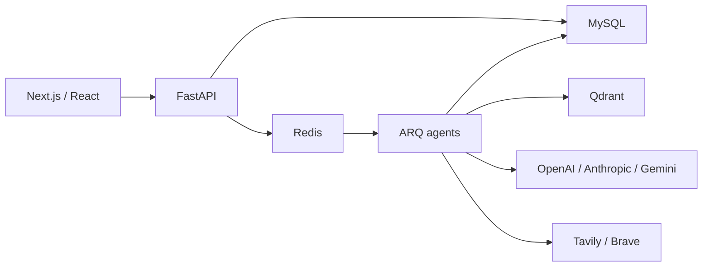

# ResearchOS

A multi-agent research workspace that plans investigations, retrieves evidence, assesses claims and produces citation-backed reports with human approval. Built as a GenAI engineering portfolio: the core workflow is real, and gaps are documented rather than disguised as integrations.

## Start locally

```bash
cp .env.example .env
docker compose up --build
```

Open **http://localhost:3000**, register, create a project and start research. Choose **DEMO** to exercise the worker, plan approval, event streaming, source inspection, report review and PDF export without API credentials. Demo evidence is a labeled local fixture, not a response to your real-world topic.

For **LIVE** research configure one generation key (`OPENAI_API_KEY`, `ANTHROPIC_API_KEY` or `GOOGLE_API_KEY`), matching `LLM_PROVIDER` / `LLM_MODEL`, and `SEARCH_API_KEY` for Tavily or Brave. Document embeddings independently require `OPENAI_API_KEY`. Missing credentials produce visible failure states. API keys never enter the browser.

## Why build this?

Research requires more than a conversational answer. This project makes the plan, evidence, verification limits, provider usage and human checkpoints inspectable. It demonstrates controlled orchestration, background execution, RAG, tenant authorization and reproducible measurements.

## Architecture



The manager returns a Pydantic plan. After approval, code runs actual search/fetch and document retrieval tools. The analyst returns evidence-linked findings; a separate verifier assesses support and deterministic validation checks citation IDs and exact quotes. The writer organizes existing findings and returns a draft for final review. Safe activity events are persisted and streamed through SSE. No private chain of thought is displayed.

## RAG and tools

PDF, TXT, Markdown and CSV uploads are validated and parsed into page-aware overlapping chunks. Dense embeddings are stored in organization-filtered Qdrant. BM25-style lexical scoring is fused with semantic ranks, followed by an interchangeable lexical reranker and source diversity cap. MySQL stores text and provenance, not primary vector retrieval.

Web fetching validates DNS, pins connections to a public IP and checks redirects. Calculations and CSV statistics use fixed operations, never model-written Python or unrestricted SQL. Provider retries, timeouts, context limits, tool-call ceilings and spending checks bound the workflow.

## Security, measurement and cost

Argon2 passwords, opaque server sessions, HttpOnly cookies, CSRF/origin checks, server-enforced organization roles and tenant predicates protect resources. Source content is untrusted data. Report HTML is escaped. Upload filenames never become server paths.

Provider-reported generation token counts and request IDs are persisted with latency. Dollar amounts are **estimates** based on configurable price settings. Search costs are estimated per configured call price; demo provider costs are zero. Embedding costs are not yet included in the research ledger.

Evaluation computes topic coverage, expected-source recall, citation mapping precision, citation coverage and model-assessed support from actual reports. Missing denominators are null. These are not independent accuracy guarantees. Dataset-wide semantic benchmarking is a future extension.

## Development and testing

See [development](docs/DEVELOPMENT.md) for Python / Node setup. Run `make test`, `make eval`, `make lint`, `make typecheck`, `make security`, and `make build`, or use their commands directly on Windows. Browser tests target a running stack from `apps/web` with `npm run test:e2e`.

Optional seed: register an account, set `SEED_EMAIL` to it, and execute `scripts/seed.py` in a configured API environment. The seed creates labeled example projects and no fake metrics. Docker uses persistent MySQL, Redis and Qdrant volumes; Alembic runs before API and worker. GitHub Actions runs Python checks, frontend build and Compose/Playwright integration.

## Documentation


- [Architecture and implementation plan](docs/ARCHITECTURE.md)
- [Agent contracts](docs/AGENTS.md)
- [API](docs/API.md), generated OpenAPI at http://localhost:8000/docs
- [Evaluation definitions](docs/EVALUATION.md)
- [Security and remaining threats](docs/SECURITY.md)
- [Deployment](docs/DEPLOYMENT.md)
- [Verification results](docs/VERIFICATION.md)

## Known limitations and future improvements

This is a functional portfolio foundation, not a claim of enterprise readiness. The complete requested feature set remains broader than this implementation. Pending items include delivered email verification/password reset, MFA/SSO, membership administration, encrypted per-tenant API-key management, malware scanning / process-isolated parsing, atomic organization spend reservations, embedding usage ledgers, dataset-wide evaluations, production telemetry integrations, rich project memory, model routing and scalable lexical indexing. Live provider behavior requires real credentials. Source verification is evidence provenance plus model assessment, not a guarantee of truth.

Performance numbers and screenshots belong in the verification report only after measurement. Production rollout requires the deployment hardening and security review in the linked documents.
