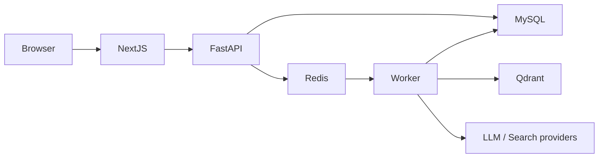
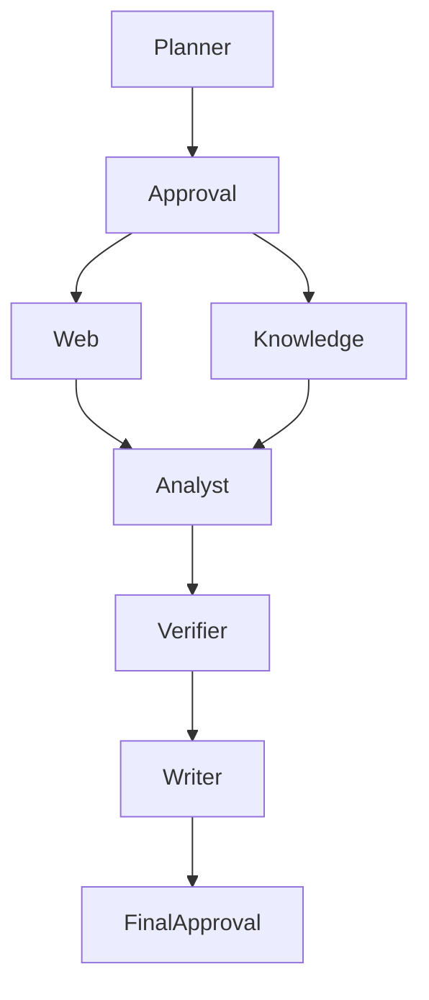
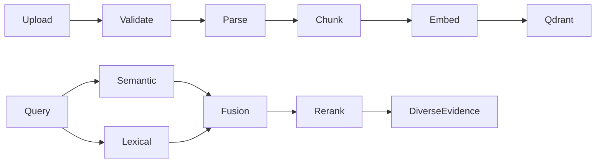
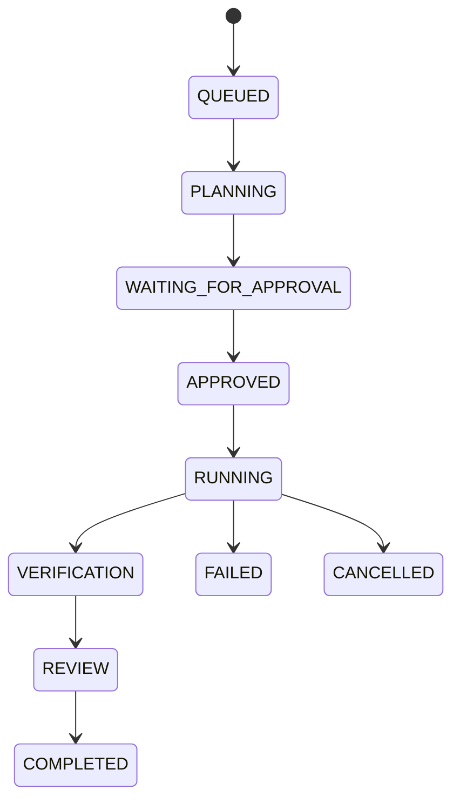

# ResearchOS architecture

Repository inspection: the initial workspace was empty; no dependencies, reusable components, or existing functionality were present.

## Implementation plan

1. Establish a Next.js App Router / FastAPI monorepo and operational documentation.
2. Add SQLAlchemy relational storage, migrations, cookie sessions, organizations and server-side roles.
3. Add projects and validated document ingestion, chunking and Qdrant indexing.
4. Implement semantic + lexical retrieval, reciprocal rank fusion and an interchangeable reranker.
5. Implement bounded agent stages with durable state, Redis worker dispatch, approvals and cancellation.
6. Integrate configurable LLM and search providers with schema validation and measured usage.
7. Ground claims in persisted evidence, separately verify supporting quotes and export reports.
8. Deliver responsive UI, replayable SSE traces and evidence inspection.
9. Add reproducible evaluations, security regression tests, Docker and CI.

## System

MySQL is the system of record. Redis dispatches ARQ jobs and enforces limits. Qdrant stores dense embeddings with mandatory organization filters. Document text and metadata remain in SQL for keyword ranking and provenance. SQLite is an explicit test/development adapter, not the production default.

The worker records operational events, not chain of thought. Retries are bounded. A database state transition prevents duplicate execution. Failures remain visible and cancellation is checked between stages.

## Boundaries

The LLM proposes structured plans and claims. Code owns authorization, network access, calculations, citation IDs, budget accounting and transitions. An exact evidence quote only proves provenance; semantic claim support is a separate model assessment and is never advertised as objective truth. Production deployment requires TLS, secret management, backups, operational monitoring and a dedicated security review.
