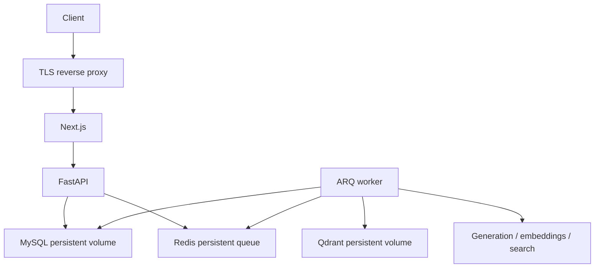

# Deployment

Local: copy `.env.example` to `.env`, then `docker compose up --build`. MySQL migrations run before API and worker. Register at http://localhost:3000. Use DEMO without credentials; configure provider keys for LIVE. No fixed demo login or plaintext seeded password exists.

For production replace local credentials, set ENVIRONMENT=production, PUBLIC_ORIGIN to the exact HTTPS application origin and AUTH_SECRET to a random value. Use a secrets manager, a private network, TLS termination, authenticated database/cache/vector services, managed backups, readiness checks and a reviewed egress policy. Configure generation input/output and search price estimates for your selected model. Do not expose Redis, MySQL or Qdrant directly to the internet.

Compose is intended for local setup, not a high-availability deployment. See SECURITY.md before public exposure. Run CI and E2E against an isolated test stack; live provider tests should use a dedicated low-budget project.
