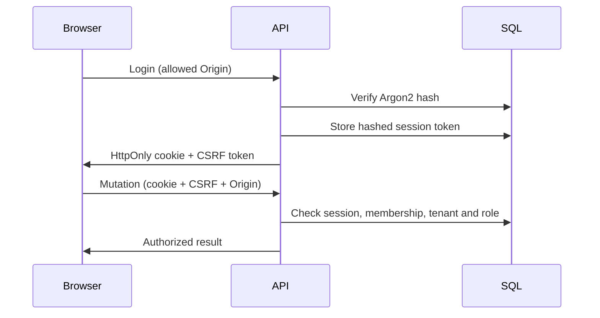

# Threat model and controls

Tenants, submitted questions, uploaded files, retrieved pages and LLM output are all untrusted. The protected assets are documents, research, reports, membership state, provider credentials and infrastructure.

## Implemented controls

- Argon2 hashes; random opaque HttpOnly session cookies stored only as SHA-256 hashes in SQL. Seven-day expiry and immediate logout revocation. Secure flag in production, SameSite=Lax.
- Mutation origin checking and per-session CSRF tokens. Authentication endpoints also require the configured origin.
- Server-side membership and role checks. Tenant predicates on every resource lookup and Qdrant retrieval.
- SQLAlchemy bound queries; no arbitrary SQL or shell execution exposed to models. The SQL allowlist exists for future narrowly scoped query tools.
- Fetching rejects unsafe schemes, ports, userinfo and non-global DNS results. Connections pin the validated IP while preserving TLS hostname verification. Every redirect is validated. No environment proxy, bounded redirects, download size and timeout.
- External evidence is labeled untrusted. Versioned prompts, validated Pydantic outputs, citation IDs checked against persisted sources, supporting quote checks, suspicious instruction detection and bounded tools.
- Upload type, byte-size, PDF signature, page-count and extracted-text limits. No executable files persisted; client filenames never become paths. Scanned PDFs fail clearly without silently inventing text.
- Same-origin frontend proxy; no API credentials sent to clients. React text escaping and escaped report HTML/PDF text. JSON logs exclude request bodies and credentials.
- Browser hardening: a per-request nonce Content-Security-Policy with `strict-dynamic` (`apps/web/proxy.ts`), HSTS, `Permissions-Policy`, `frame-ancestors 'none'` and COOP. API responses carry `default-src 'none'; sandbox`, so even the HTML export cannot run script.
- Per-account and per-IP throttling on login and registration. Client identity comes from `X-Forwarded-For` only through `TRUSTED_PROXY_COUNT` trusted proxies, counting from the right, so spoofed left-hand entries are ignored.
- Redis rate limits, agent step / context / tool limits, per-research spending ceilings and organization recorded-cost ceiling. Docker internal services are not published to host ports.

## Remaining risks and deployment requirements

**Client identity and the edge proxy.** Next's rewrite proxy adds no `X-Forwarded-For` and passes a client-supplied one through unchanged (checked against the production build), so the API cannot trust it directly. Compose therefore puts a Caddy edge proxy (`docker/Caddyfile`) in front of the web container. With no `trusted_proxies`, Caddy treats clients as untrusted and sets the header itself, and the API trusts exactly one hop (`TRUSTED_PROXY_COUNT=1`, set in `docker-compose.yml` for the API only). The web container is no longer published to the host. The API is still published on `127.0.0.1:8000` for OpenAPI; a request sent straight to it can spoof the header, so do not publish it beyond loopback. If you run your own proxy chain, set the count to the number of proxies that append the client address. A wrong value lets clients choose their rate-limit identity.

The Caddyfile could not be executed in the authoring environment. CI validates it with the official image and checks, through the edge, that the CSP header is present, the `Server` header is absent, and rotating `X-Forwarded-For` values still hits the rate limit.

**CSP scope.** The CSP was verified in headless Chromium on the public pages (no violations, hydration intact, fresh nonce per request). Signed-in pages were not exercised without a running API; the Playwright job in CI is the check for those. Every page now renders dynamically, which nonces require.

This is a portfolio implementation, not a completed enterprise security certification. Add managed TLS, secret rotation, MFA/SSO, delivered password recovery and email verification, malware scanning, backups, dependency scans and external penetration testing before public production exposure. The current parser runs in a thread within the API; hostile PDFs require process/container isolation. Lexical retrieval is capped at 10,000 chunks; use a scalable tenant-filtered lexical index at larger scale. Generation pricing is configured rather than fetched from vendor billing.

Organization ceilings apply to cumulative recorded costs and are not atomic cross-job reservations; concurrent provider calls can overshoot. Task-level preflight reserves configured output capacity but tokenization is conservative approximation. Add transactional organization reservations and separate search/embedding ledgers before paid multi-tenant deployment. Budget exhaustion does not interrupt an in-flight provider call. Cancellation is cooperative; it stops at the next checkpoint.

Prompt injection detection is heuristic, not a security guarantee. Deterministic tool/network boundaries are the primary defense. A model-assessed VERIFIED claim may still be wrong; evidence and uncertainty are inspectable. Operational traces do not include chain of thought. Staff should inspect provider errors and logs without exporting sensitive data.
