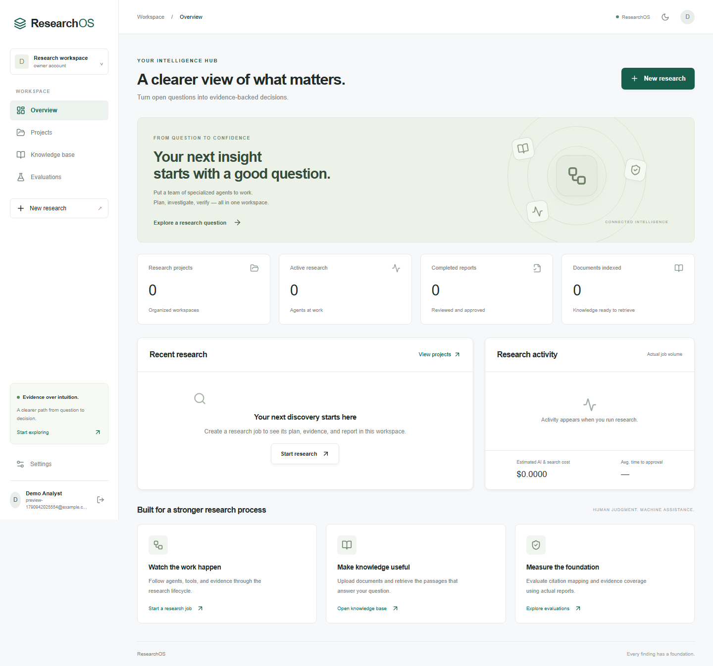
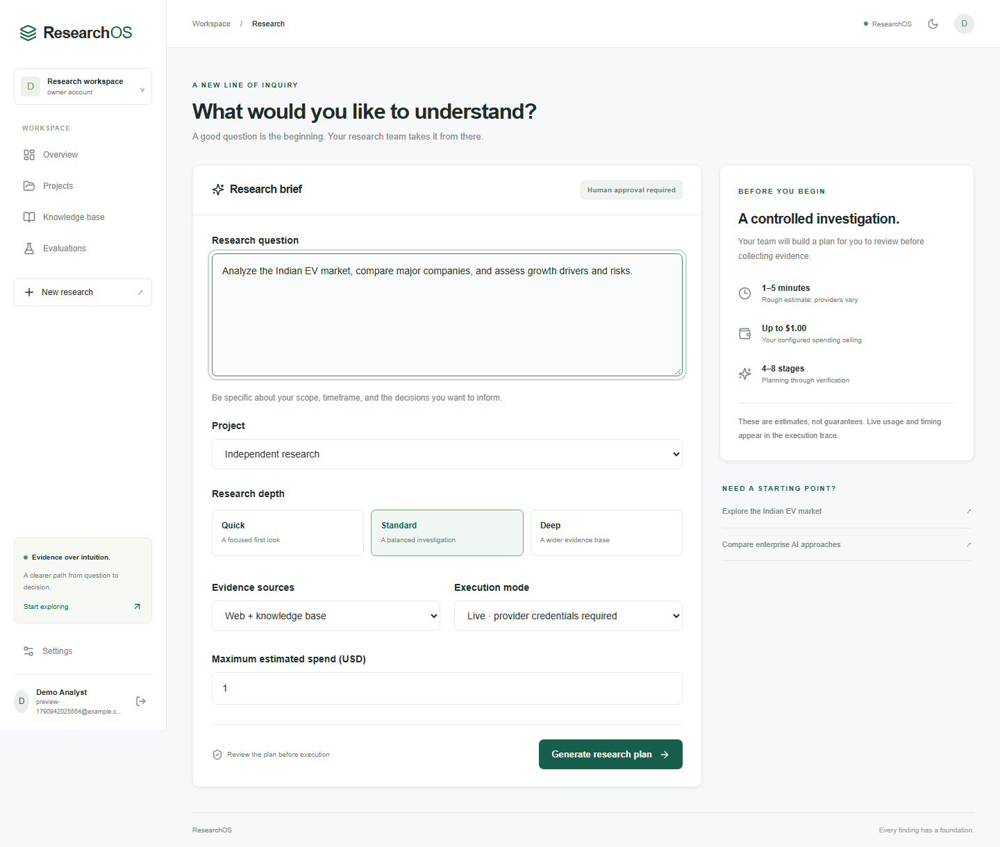

# Verified engineering results

Verified locally on October 2, 2026. This records executed checks, not assumed production readiness.

| Check | Result |
|---|---|
| Docker build and startup | MySQL, Redis, Qdrant, API, worker and web running |
| MySQL migrations | Revision `0002` at head; immutable initial schema and LONGTEXT document migration |
| Backend suite inside Docker | **37 passed in 31.40 seconds**, including real Qdrant indexing and tenant filtering |
| Browser workflow | **1 passed**; final test journey 19.8 seconds, runner 26.8 seconds |
| Frontend production build | Passed with Next.js 16.3.8 |
| Frontend lint / strict TypeScript | Passed |
| Python Ruff / mypy | Passed; 18 application modules checked by mypy |
| Dependency audit | npm install reported zero known vulnerabilities after the patched Next.js upgrade |
| Guarded HTTPS fetch | Retrieved example.com through the validated, IP-pinned transport; 713 bytes returned |
| Redis | PING returned PONG; browser research jobs executed through the actual ARQ worker |
| Evaluation regression | Actual deterministic computation over an explicitly synthetic fixture |
| Desktop / mobile / input UI | Captured and visually inspected at 1440px and 390px widths |
| GitHub Actions | Workflow authored; equivalent checks run locally. No remote Actions run was performed |
| Live generation / embedding / search vendors | Adapters implemented; **not exercised against paid providers because keys were not supplied** |

The browser test covers registration, dashboard, project creation, demo plan approval, Redis-worker execution, live activity streaming, source inspection, report approval, PDF download, ~90 KB upload, report evaluation, model settings and logout. Demo content is labeled and does not answer a real-world question. Missing embedding credentials produce an honest indexing failure rather than a fake indexed status.

The live graph regression injects labeled generation, search and page fixtures into the real orchestration and SQL persistence path. It verifies fabricated-citation rejection, exact-quote grounding, usage persistence, deterministic 25% growth from quoted 100/125 inputs, and rejection of an invented numeric input. The separate vector integration uses injected three-dimensional test embeddings with the **real Qdrant service**. These tests establish workflow correctness, not real-world research accuracy or retrieval quality.

## Engineering report

- **Architecture:** Next.js App Router and React frontend, modular FastAPI backend, SQLAlchemy/MySQL storage, Alembic migrations, Redis/ARQ workers, Qdrant vectors. SQLite is a test adapter.
- **Implemented features:** Cookie auth, organization roles and isolation, projects, validated uploads, asynchronous indexing, bounded research jobs, plan and final approvals, cancellation, replayable SSE, evidence inspection, report evaluation, settings, four export formats, Docker and CI configuration.
- **Agents:** Manager/planner, deterministic web and knowledge researchers, structured analyst, separate fact checker, report writer. Operational traces contain actions and results rather than hidden reasoning.
- **Tools:** Allowlisted search, guarded webpage fetch, tenant-filtered document search, source-grounded Decimal calculator. CSV descriptive-statistics utility is implemented and unit tested; unrestricted Python and SQL execution are not exposed.
- **RAG:** Page-aware overlapping chunks, OpenAI embeddings into tenant-filtered Qdrant, BM25-style lexical scoring, reciprocal rank fusion, replaceable reranker, source diversity limits.
- **Security:** Argon2, hashed opaque sessions, CSRF/origin checks, role gates, tenant predicates, SSRF/redirect protection, source/data separation, schema validation, upload limits, parameterized SQL and rate limiting. See SECURITY.md for remaining risks.
- **Evaluation:** Persisted report-derived topic/source coverage, citation mapping and assessed support. Undefined metrics are null. No semantic accuracy benchmark has been fabricated.
- **Performance:** Bounded concurrent page downloads and background execution. Browser journey timing above is a demo test, not a live research latency benchmark.
- **Cost tracking:** Provider-reported generation token fields, request IDs and latency; configurable estimated generation/search dollars, per-task ceilings and recorded organization cost. Embedding costs and atomic cross-job reservations remain extensions.
- **Deployment:** Copy `.env.example` to `.env`; run `docker compose up --build`; register at http://localhost:3000. Configure matching provider/model/search keys for live research and OpenAI credentials for embeddings.
- **Known limitations / next work:** The complete enterprise specification is **not fully implemented**. Delivered verification/recovery email, MFA/SSO, membership administration, encrypted per-tenant key management, atomic organization reservations, production telemetry, malware scanning, process-isolated parsers, dataset-wide semantic evaluations, scalable lexical indexing and automatic recovery of interrupted workers remain. Public production deployment requires additional hardening.

## Screenshots

Mobile capture: [dashboard-mobile.png](screenshots/dashboard-mobile.png).
